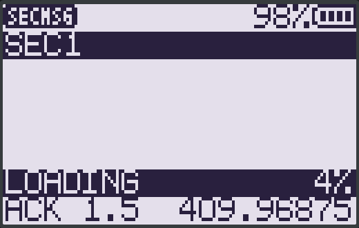

# SECMSG — encrypted messenger overlay App for the F4HWN 8K firmware

<p align="center">
  <a href="https://buymeacoffee.com/busybin"></a>
</p>

A single-file overlay App for the **Quansheng UV-K1 / UV-K5 V3 (PY32F071)**
running F4HWN firmware **with the 8 KiB overlay window**: short encrypted messages over the
BK4819 FSK modem, keyed by an 8-digit PIN, with delivery receipts and a 43-message history.



> **⚠️ This App requires the F4HWN firmware with the 8 KiB overlay window.**
> It is linked for `code+bss ≤ 8192 B` and declares **`api_min = 4`** (the 8K fork's API level:
> upstream level 3 plus `uid_get` at offset 396). The loader refuses it on other firmware
> (`APP_ERR_ABI`) instead of crashing, and on the stock 4 KiB firmware its `.bss` would overrun
> the stock workspace anyway. Get the firmware here:
> **[busybin/uv-k1-k5v3-firmware-f4hwn-8k](https://github.com/busybin/uv-k1-k5v3-firmware-f4hwn-8k)**
> (on-screen version `F4HWN v6.3.0+8K`).

## ⚖️ Legal notice — read before use

**Encryption on amateur-radio frequencies is restricted or prohibited in many jurisdictions.**
For example, in the United States 47 CFR §97.113 prohibits obscuring the meaning of a
communication on amateur bands; other countries have their own rules ranging from a total ban
on encrypted amateur traffic to permissive regimes. This App is published for **research,
education and lawful use only**. It is your responsibility to check the regulations that
apply to you and to your licence before transmitting encrypted traffic. Nothing here is legal
advice, and no warranty of any kind is provided. Do not use it to break any law.

## 🔐 Security reality — read before trusting it

This is a hobby implementation, not a vetted cryptosystem:

- The cipher is **Speck128/128 in CTR mode** with a hand-written implementation (validated
  against the published Speck test vectors on the host), and the MAC is a custom construction.
  Neither has been professionally audited.
- The key schedule comes from an **8-digit PIN** through a lightweight KDF (16 384 Speck
  rounds, ~1–2 s on the MCU, run incrementally in the background so the UI stays alive).
  An 8-digit PIN is roughly 26 bits of entropy — **this is not strong protection** against a
  determined attacker. Treat it as "keeping neighbours out", not as secrecy.
- There is **no global replay protection** and no forward secrecy. Message counters are
  per-device; a captured frame can be replayed within its counter window.
- The crypto core passes NSA KAT vectors, CTR round-trips, MAC tamper rejection and KDF
  avalanche tests on the host (see `tests/crypto_test.c`); that validates correctness of the
  primitives, **not** the security of the protocol design.

## Features

- **Encrypted messaging** over the BK4819 FSK modem (72-byte frames, 36-byte packets:
  nonce ∥ counter ∥ ciphertext ∥ MAC), same channel + same PIN on both ends.
- **Device identity** from the PY32 unique ID (`uid_get`), shown on the top row; both radios
  derive it independently, nothing to configure.
- **Delivery receipts** — automatic ACK ~1.5 s after a clean frame (tunable 0.5–10 s);
  `✓` on receipt, `✗` on timeout, `N` when a frame was truncated or the chip CRC failed.
- **PIN panel** (`F+0` or `MENU`), background key derivation with `LOADING NN%` progress,
  input is locked while the key schedule is being computed.
- **Message box** — received bold, sent normal with `TX ` prefix, 16-char wrapping,
  **43 messages of history** (needs the 8 KiB window; 1-pixel-per-row scroll indicator was
  dropped in favour of history depth), input row shows remaining characters.
- **Prosigns** — `F` latch + digit inserts a prosign (same set as the CW App). Defaults:

  | `F+1` | `F+2` | `F+3` | `F+4` | `F+5` | `F+6` | `F+7` | `F+8` | `F+9` |
  | --- | --- | --- | --- | --- | --- | --- | --- | --- |
  | CQ | DE | UR | RST | R | TU | 73 | AR | SK |

  Edit them **per radio** from the flasher page's **Prosigns** tab — it rewrites the table in
  the installed App in place, no reinstall.
- **Safety** — refuses to transmit when TX is disabled/battery low/offset differs; keeps the
  draft on TX refusal; drains a stuck key; re-arms the RX FIFO on any anomaly.

## Keys

| Key | Function |
| --- | --- |
| `PTT` | send (requires a full 8-digit PIN and non-empty buffer, else `BUSY`) |
| `UP` / `DOWN` | scroll the message box (clamped at both ends) |
| `MENU` | settings page (PIN / ID / ACK rows; `UP`/`DOWN` select, `MENU` edits, `EXIT` saves) |
| `EXIT` | press twice within 1.5 s to leave (config saved on exit) |
| `0`–`9` | multitap text input (and PIN digits inside the PIN panel) |
| `0` | backspace — delete the last character (message / ID input) |
| `*` | space (message / ID input); **clears the whole PIN entry** in the PIN panel |
| `F` short | latch — `F+0` opens the PIN panel |
| `F` double | clear compose buffer + message box |

## Install

1. Flash the **8K firmware** (link above).
2. Nothing to download if you use the flasher page below; otherwise run `./build.sh`
   (see _Building_) or take the prebuilt package from the
   [latest release](https://github.com/busybin/F4HWN-Encrypted-Messenger-App/releases/latest).
3. Install with [UVStudio](https://armel.github.io/uvstudio/) (or a local mirror) into any App
   slot — e.g. slot 2.
4. Radio → Apps menu → **SECMSG**, then `F+0` and enter an 8-digit PIN on both radios.

Both radios need the same channel, the same offset setting and the same PIN.

## How to use

**1. Set the PIN first — on both radios.**
- Open the PIN panel: `F+0` (or `MENU` → the PIN row → `MENU`).
- Type the 8 digits with `0`–`9`; digits are appended one by one.
- **`*` clears the whole entry.** There is **no single-character delete** — to fix a typo press
  `*` and retype from the start.
- `MENU` confirms the row; `EXIT` saves and leaves.
- **Both radios must use the same 8-digit PIN** (same channel, same offset).
- With a PIN set, every launch re-derives the session key in the background and shows
  **`LOADING NN%`** for a few seconds (input is locked meanwhile). **With no PIN set there is no
  derivation and no `LOADING` line** — set the PIN first, then it appears.

**2. Compose and send.**
- Compose with `0`–`9` (multitap — e.g. tap `2` repeatedly for `A`/`B`/`C`/`2`).
- `0` = **backspace** (delete the last character); `*` = **space**.
- `PTT` sends (needs a full PIN and a non-empty buffer, else `BUSY`).

**3. Read the result.**
- Received text is bold; sent text is prefixed `TX `.
- The delivery receipt arrives ~1.5 s after a clean send: `✓` = received, `✗` = timed out,
  `N` = frame truncated / chip CRC failed.

## Building

```bash
./build.sh            # needs arm-none-eabi-gcc 13.x on PATH (or TC=/path/to/bin)
```

Budget: **code 6820 B + bss 1356 B = 8176 / 8192 B** of the overlay window.

Version 26 follows the v6.3.0 firmware: `uid_get()` moved from offset 276 to 396 (an older
package would read the wrong table entry, so V25 must be replaced), the screen is drawn with
`blit_page(8)` so no blocking K5Viewer frame runs while a message is decoded (the viewer is fed
from the idle loop), and the frequency/PIN formatting uses the resident `append_u32` and
`uidivmod` services instead of a repeated-subtraction divider.

## Host test suite

The App logic runs on the host (a mocked BK4819 FIFO and firmware API), so the whole
behaviour is testable without a radio:

```bash
for f in tests/*.c; do gcc -O1 -o /tmp/secmsg_test "$f" && /tmp/secmsg_test || echo "FAIL $f"; done
```

Twelve suites (the prosign suite follows the current CQ/DE/UR/RST/R/TU/73/AR/SK table):
crypto (NSA KAT / CTR / MAC tamper / KDF avalanche), end-to-end packet
build+parse, ACK timing, receipt counters, input lock during key derivation, menu editing,
layout, scrolling, prosigns, session/state and vectors. Add `-fsanitize=address,undefined`
for the sanitizer run used during development.

## Licence & attribution

Apache-2.0 (see [LICENSE](LICENSE)). The App uses the overlay-App platform of the F4HWN
firmware (Apache-2.0) — see [NOTICE.md](NOTICE.md). The App itself is an original work.

